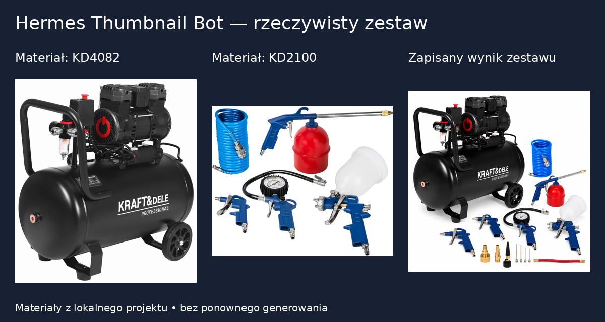
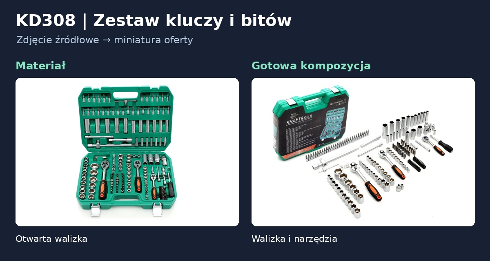

# Hermes Thumbnail Bot

**Dla oceniających:** [uruchom demo bez konta i kluczy](QUICKSTART.md).

**Masz już zdjęcia produktów? Przygotuj z nich spójne miniatury do sklepu i na marketplace bez zamawiania nowej sesji dla każdego SKU.**



**Rzeczywisty przykład:** kompresor KD4082 i akcesoria KD2100 → jedna miniatura oferty. Pokazujemy zapisany wynik z istniejącego projektu, a nie obraz wygenerowany przez publiczny profil. Zobacz [opis przypadku i zdjęcia](docs/real-case-review.md).

## Przykłady miniaturek do e-commerce

- **Jeden produkt z wielu stron.** Z osobnych zdjęć kompresora przygotuj spójną galerię: przód jako miniatura główna, bok i tył jako kolejne ujęcia. Każde zdjęcie eksportujesz w tym samym formacie, z podobnym marginesem. Profil nie tworzy widoku tyłu ze zdjęcia przodu.
- **Zbliżenie na detal.** Dodaj do galerii osobne zdjęcie manometru, przyłączy albo panelu sterowania, żeby kupujący mógł je obejrzeć bez powiększania głównej miniatury.
- **Zestaw w jednej ofercie.** Pokaż produkt i dołączone akcesoria na jednym obrazie — jak w [opublikowanym przykładzie KD4082 + KD2100](docs/real-case-review.md). Kompozycję przygotowujesz osobno i importujesz do profilu do końcowego eksportu.
- **Spójna seria wariantów.** Przygotuj miniatury dla kilku kolorów lub rozmiarów na podstawie zdjęcia każdego wariantu. Ustaw ten sam format i marginesy, bez cyfrowego przemalowywania produktu.

### KD308: zestaw kluczy i bitów



***Rzeczywisty przykład:** otwarta walizka. **Gotowa kompozycja:** walizka i narzędzia. Po prawej pokazano zdjęcie wygenerowane jako miniatura oferty.

Materiały w `demo/` nie są objęte licencją MIT.

## Instalacja

Wymagania: [Hermes Agent](https://hermes-agent.nousresearch.com/docs/) i ImageMagick 6 lub 7. Po sklonowaniu repozytorium uruchom z jego katalogu poniższe polecenia. Użyj nowej nazwy profilu; jeśli `catalogdemo` już istnieje, wybierz inną nazwę i zmień ją we wszystkich poleceniach. Nie wykonuj kolejnych kroków, jeżeli tworzenie profilu się nie powiedzie.

```sh
hermes profile create catalogdemo --no-alias --no-skills && (
  set -eu
  conf=$(hermes -p catalogdemo config path)
  profile_dir=$(dirname "$conf")
  install -m 644 profile/SOUL.md "$profile_dir/SOUL.md"
  mkdir -p "$profile_dir/skills/catalog-thumbnail"
  install -m 644 profile/skills/catalog-thumbnail/SKILL.md "$profile_dir/skills/catalog-thumbnail/SKILL.md"
  hermes -p catalogdemo config set memory.memory_enabled false
  hermes -p catalogdemo config set memory.user_profile_enabled false
  hermes -p catalogdemo config set security.redact_secrets true
  hermes -p catalogdemo skills list --source local
)
```

Wybierz własny model poleceniem `hermes -p catalogdemo setup model`. Uruchom `hermes -p catalogdemo chat -s catalog-thumbnail -t terminal`. Rozmowa z Hermesem zależy od wybranego modelu; sam eksport obrazu wykonasz offline bez konta i klucza API według [instrukcji i ustawień renderowania](docs/workflow.md). [Przykładowa konfiguracja](profile/config.example.yaml) nie zawiera danych logowania.

To publiczna wersja profilu do lokalnej obróbki, nie kopia systemu produkcyjnego. Nie odtwarza automatycznie kompozycji pokazanej wyżej.

## Jak wygląda proces

1. Podajesz zdjęcie, do którego masz prawo.
2. Jeśli chcesz wygenerować wariant w ChatGPT, robisz to ręcznie w przeglądarce i zapisujesz obraz. Lokalny etap nie wymaga klucza API ani dostępu do sesji.
3. Narzędzie lokalnie ujednolica kadr, tło, marginesy i format eksportu. Przed publikacją sprawdzasz zgodność produktu, koloru i etykiety ze zdjęciem źródłowym.

## Ile to może kosztować?

Przy **100 gotowych miniaturach**, **3 minutach pracy na sztukę**, stawce **60 zł/h** i **50 zł kosztów narzędzi przypisanych do partii**, koszt wynosi **350 zł**, czyli **3,50 zł za zaakceptowaną miniaturę**. To model kosztowy, nie wynik pilota, cena subskrypcji ani obietnica konkretnej wydajności.

Dla porównania [Marszał Studio](https://marszalstudio.pl/fotografia-produktowa-cennik/) podaje **39 zł netto / 47,97 zł brutto** za packshot na białym tle bez retuszu. To cena wykonania zdjęcia od zera; nasz scenariusz zakłada, że zdjęcie już istnieje. Nie są to usługi 1:1. Zobacz [założenia i sposób pomiaru](docs/cost-benchmark.md).

Demo zawiera tylko wybrane materiały produktowe, bez pełnego katalogu, ciasteczek ani danych logowania. Wersja publiczna nie automatyzuje logowania ani pobierania wyników z ChatGPT i nie zakłada obchodzenia limitów.
